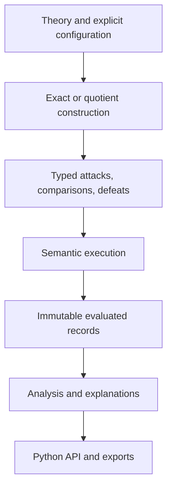

# ArgForge

**A Platform for Structured Argumentation Analysis and Explanation**

Technical reference and formal foundations

**ArgForge is built for computational argumentation in Turkish as well as in English.** Theories can be written with Turkish keywords and Turkish statements, explanations and error messages are available in Turkish, and the [English–Turkish dictionary](#englishturkish-dictionary) at the end of this document gives the Turkish name of every keyword and concept.

ArgForge turns an explicit theory of premises, axioms, inference rules, conflicts and preferences into structured arguments, raw attacks, successful attacks (defeats), extension families, claim assessments and inspectable explanations. It is intended for maintainers, reviewers, researchers and anyone building on it.

---

## 1. Summary

ArgForge connects the layers of structured argumentation. For any claim you can see which derivations support it, where attacks land, how preferences decide those attacks, and what changes when the configuration changes.

**Scope.** Finite, ground, ASPIC+-style argumentation. ArgForge is not a natural-language inference engine, a first-order theorem prover, or a source of factual truth.

**Recursive theories.** A central design choice is a finite *quotient* construction for theories whose rules allow infinitely many finite argument trees. Rather than fixing a maximum derivation depth, it:

- groups arguments by a preference-aware signature;
- saturates the finite space of signatures;
- keeps one finite representative of each class for inspection.

It is designed so that claim acceptance under the supported semantics is the same as for the full, infinite set of arguments, while keeping an explicit framework that can be shown and explained. Section 7 states exactly what is preserved and how this was argued. It is not claimed to be the fastest, the smallest, or the first such approach.

## Getting started

ArgForge needs **Python 3.10 or newer**. Its only dependencies are the Clingo answer-set solver and its two helper libraries.

**Install it into a virtual environment:**

```
git clone https://github.com/ieddeveci/ArgForge.git
cd ArgForge
python -m venv .venv
```

Activate the environment (`.venv\Scripts\activate` on Windows, `source .venv/bin/activate` on Linux and macOS), then install ArgForge:

```
pip install .
```

To use the code straight from the folder instead, run `pip install -r requirements.txt` and work inside the `ArgForge` folder.

**Check that it works:**

```
python -c "import argforge as af; r = af.solve('[premise: bird]\n[defeasible r1: bird => flies]'); print(r.claim('flies').status)"
```

This prints `JUSTIFIED`. The next section shows everything ArgForge can do, with an example for each.

## What you can do with ArgForge

ArgForge is a Python library: you import it with `import argforge as af`. It has no command-line program, no user interface and no network access. Everything it does is listed below, each with a short example. All the examples use this theory, written once with English keywords and once with Turkish keywords:

```python
EN = """
[premise: bird]
[premise: penguin]
[defeasible r1: bird => flies]
[defeasible r2: penguin => -flies]
[prefer_rule: r2 > r1]
"""

TR = """
[öncül: kuş]
[öncül: penguen]
[feshedilebilir r1: kuş => uçar]
[feshedilebilir r2: penguen => -uçar]
[kural_tercihi: r2 > r1]
"""
```

### Writing and checking theories

**1. Write a theory as text and parse it.** Premises, axioms, strict and defeasible rules, undercuts, rule and premise preferences, contraries and contradictories can be written with English or Turkish keywords, and statements can be written in any language, including Turkish.

```python
import argforge as af

theory = af.Theory.parse(TR)
print(len(theory.facts), len(theory.rules))
print(theory.to_source())
```

`to_source()` writes the theory back in canonical form, with English keywords; the statements themselves keep their Turkish text.

Errors in a theory are reported in English or Turkish:

```python
import argforge as af

try:
    af.Theory.parse("[öncül kuş]")
except Exception as error:
    print(error.render("ENG"))
    print(error.render("TUR"))
```

**2. Build a theory in Python,** declaration by declaration.

```python
import argforge as af

theory = (
    af.TheoryBuilder()
    .premise("bird")
    .premise("penguin")
    .defeasible("r1", ["bird"], "flies")
    .defeasible("r2", ["penguin"], "-flies")
    .prefer_rule("r2", "r1")
    .build()
)
print(af.solve(theory).claim("flies").status)
```

**3. Check a theory before evaluating it:** whether the well-definedness conditions of ASPIC+ hold, adding the missing contrapositives of strict rules, and warnings about the way it is written.

```python
import argforge as af

theory = af.Theory.parse("[premise: p]\n[premise: -q]\n[strict s1: p -> q]")
print(af.diagnose(theory))
print(af.close_under_transposition(theory).to_source())
print(af.lint("[premise: bird]\n[defeasible r1: brid => flies]"))
```

### Evaluating

**4. Evaluate a theory** with a chosen semantics (grounded, complete, preferred, stable, semi-stable, ideal, eager, naive, admissible or conflict-free), argument ordering (last link or weakest link), set comparison (elitist or democratic), with or without contrapositives, with a policy for cyclic rules and a time limit. An evaluation can also run in a separate, time-limited process, and a `Reasoner` reuses work across evaluations.

```python
import argforge as af

result = af.solve(EN, semantics="preferred", ordering="weakest_link",
                  set_ordering="democratic", transposition=True,
                  cycle_policy="QUOTIENT", timeout=60)
print(result.status, result.claim("flies").status)

isolated = af.solve(EN, isolated=True, timeout=30)
print(isolated.status)

reasoner = af.Reasoner()
print(reasoner.solve(TR).claim("uçar").status)
```

**5. Read the results:** arguments, attacks (with their type and whether they succeed), defeats, extensions, labellings, the grounded extension, and the status of every claim and argument.

```python
import argforge as af

result = af.solve(EN)
for argument in result.arguments.values():
    print(argument.alias, argument.text, result.argument_status(argument.alias).grounded_label)
for attack in result.attacks:
    print(result.arguments[attack.attacker].alias, attack.type, result.arguments[attack.target].alias, attack.succeeds)
print(len(result.defeats), len(result.extensions), len(result.labellings))
for claim, info in result.claims.items():
    print(claim, info.status, info.acceptance)
```

**6. Check the guarantees of a result:** whether the rationality postulates and the well-definedness conditions hold.

```python
import argforge as af

result = af.solve(EN, transposition=True)
print(dict(result.postulates))
print(result.well_definedness)
```

### Explaining

**7. Explain** why an argument or a claim has its status, in English or Turkish, and show the dialectical tree of an argument. Every explanation includes a readable `text`, together with the structured details it is based on; `extension` selects which extension the text describes when there are several.

```python
import argforge as af

result = af.solve(EN)
print(result.explain("A4")["text"])
print(result.explain_claim("flies")["text"])

turkish = af.solve(TR)
print(turkish.explain("A4", language="TUR")["text"])
print(turkish.explain_claim("uçar", language="TUR")["text"])

print(result.explain("A3")["status"])
print(result.dialectical_tree("A4"))
```

This prints, among other things:

```
In the grounded extension: A4 is defeated by the accepted argument A3.
The claim “flies” is overruled. In the grounded extension, every argument for it is defeated: A4 by A3.
Temelli kapsamda: A4, kabul edilmiş A3 tarafından yeniliyor.
“uçar” iddiası reddedilmiştir. Temelli kapsamda onun için olan her argüman yeniliyor: A4, A3 tarafından.
```

The functions in `argforge.explanation` (claim, argument, attack, defeat and difference explanations of research records) accept `language="TUR"` in the same way.

**8. Produce and check a certificate** that an argument belongs to the grounded extension.

```python
import argforge as af

result = af.solve(EN)
proof = result.grounded_proof("A3")
print(result.verify_grounded_proof(proof))
```

**9. Turn a theory into plain English sentences.**

```python
import argforge as af

for sentence in af.nl.verbalize(EN):
    print(sentence)
```

### Analysing and comparing

**10. Analyse the attack graph** and export it as DOT (for Graphviz) or JSON.

```python
import argforge as af

graph = af.solve(EN).graph()
print(graph.metrics())
print(graph.strongly_connected_components())
print(graph.to_dot())
```

**11. Compute gradual strengths** (h-categorizer, max-based or card-based).

```python
import argforge as af

result = af.solve(EN)
print(result.strengths())
print(result.strengths(method="max_based"))
```

**12. Analyse structure:** argument features, redundant arguments, the layers of the attack graph, and the neighbourhood of attackers and defenders around an argument.

```python
import argforge as af
import argforge.analysis

result = af.solve(EN)
print(result.features())
print(result.redundancy)

record = af.evaluate(EN, af.Config())
print(argforge.analysis.graph_layers(record.evaluation))
print(argforge.analysis.dialectical_neighborhood(record, next(iter(record.arguments)), depth=2))
```

**13. Compare** two evaluations, two semantics on the same theory, or a whole grid of configurations, and test which single change in the defeats explains why a claim's status differs between two configurations of the same theory.

```python
import argforge as af
import argforge.comparison as comparison

grounded = af.solve(EN)
preferred = af.solve(EN, semantics="preferred")
print(grounded.diff(preferred))

print(comparison.compare_semantics(EN, "grounded", "preferred"))
print(comparison.compare_configurations(EN, comparison.configuration_grid()))

ORDERING = """
[axiom: a]
[defeasible low: a => b]
[defeasible high: b => p]
[defeasible mid: a => -p]
[prefer_rule: high > mid]
[prefer_rule: mid > low]
"""
last = af.evaluate(ORDERING, af.Config(ordering="last_link"))
weakest = af.evaluate(ORDERING, af.Config(ordering="weakest_link"))
print(comparison.explain_change(last, weakest, "p"))
```

### Generating theories

**14. Generate random theories** from a seed, with chosen sizes and features, or a sample of several theories.

```python
import argforge as af
import argforge.generator as generator

generated = af.generate(7, af.GeneratorParams(atoms=5, premises=3, rules=6))
print(generated.source)

accepted, skipped = generator.sample(3, max_arguments=50)
for seed, source in accepted:
    print(seed, len(source.splitlines()))
```

### Recording and exporting

**15. Make research records:** evaluate under a configuration, run many theories and configurations in one batch, export the records to JSON or CSV, and save or reload results.

```python
import argforge as af
import argforge.experiments as experiments

record = af.evaluate(EN, af.Config(semantics="preferred", ordering="weakest_link"))
print(record.status)

records = experiments.evaluate_many([EN, TR], [af.Config(), af.Config(semantics="stable")])
experiments.export_json([r.to_dict() for r in records], "records.json")
experiments.export_csv(records, "records.csv")

print(af.solve(EN).to_json()[:200])
```

## 2. Input language and theory model

A theory contains:

- ordinary premises and axioms;
- strict and defeasible rules;
- conflict declarations;
- preferences over ordinary premises and over defeasible rules.

```
[premise: bird]
[axiom: penguin]
[strict s1: penguin -> bird]
[defeasible r1: bird => flies]
[defeasible r2: penguin => -flies]
[prefer_rule: r2 > r1]
[contrary: x ^ y]
[contradictory: x ^ y] 
```

**Roles of the parts.**
- Ordinary premises can be attacked; axioms cannot be undermined.
- Strict rules encode inferences the modeller treats as non-defeasible; defeasible rules encode defeasible ones.
- An argument that ends in a strict rule is not immune to attack: an attacker can still target its vulnerable sub-arguments.

**Literals are opaque.** The language is ground and symbolic:
- `bird(tweety)` is a single string, not a predicate with unification or quantifiers.
- The engine does not know that "Zeyd is a human" and "Zeyd bir insandır" mean the same thing.

**Grammar contracts.**

- `&` is the only separator for multiple antecedents. Commas and words such as `and` or `ve` are not conjunctions.
- Reserved characters (`& > ^ [ ]` and the double quote) must be protected by quoting the literal in double quotes.
- Premises and axioms are unnamed; premise preferences refer to the literal itself.
- Rule names identify rules and can be used as literals in undercuts (`-r1`).
- English and Turkish keywords feed the same canonical model, and may be mixed in one theory.
- Antecedents form a set: a repeated antecedent counts once.
- Rules without antecedents are supported.

**Identity and order.** The identity of a theory does not depend on the order of its declarations. Declaration order is used only for presentation.

**Preferences.** Preference relations are validated, must be acyclic, and are closed transitively. If neither of two items is preferred, they are incomparable; that does not mean they are proven equally strong.

### Conflicts and rationality assumptions

**Conflicts.** Signed negation (`x` and `-x`) gives contradictory pairs. Declarations add symmetric contradictories or one-way contraries, and direction matters. Only declared formal relations count, never lexical or common-sense opposition.

**Transposition.** The optional transposition operation adds missing contrapositives of strict rules.
- It changes the evaluated theory, so the original input should be kept for provenance.
- It is not a universal consistency repair: it cannot fix contradictory axioms or an unsuitable conflict relation.

**Correct computation versus rationality guarantees.** These are separate questions. ArgForge also evaluates theories that fall outside the conditions under which ASPIC+ guarantees consistency and closure; the results follow the definitions, but those guarantees may not hold. When a condition fails, the diagnostics name it:
- contradictory axioms;
- an ill-formed contrary;
- missing contrapositives.

The native rationality report raises a theorem guarantee only when every assumption holds.

## 3. Structured arguments

**Definition.** An argument is a finite derivation tree. A premise or axiom forms a leaf; applying a rule to arguments for its antecedents creates a new argument. Different combinations of antecedent arguments give different arguments, even when they share the conclusion and the top rule.

**What is recorded.** For each argument the implementation records:
- its conclusion, top rule and top-rule kind;
- its direct and transitive sub-arguments;
- its ordinary premises and axioms;
- its strict and defeasible rules, and its last defeasible rules;
- its derivation depth, and whether it is strict and firm;
- a stable internal identity and a human-facing alias.

**Strict and firm.** An argument is *strict* if it uses no defeasible rule and *firm* if it uses no ordinary premise. A strict argument can be non-firm, and a firm argument can contain defeasible rules.

**Last defeasible rules.** These form a set, not necessarily a single rule. A strict step above several branches inherits the last defeasible rules of those branches; a new defeasible step becomes the only last defeasible rule.

**Diagrams.** Structure diagrams may share sub-arguments, drawing them as a directed acyclic graph. Such a diagram represents derivations; it is not the defeat framework. Rule-application nodes are presentation objects, not extra arguments.

## 4. Attacks, preferences and defeats

### 4.1 Three kinds of attack

| Attack | Target inside the attacked argument | Restriction |
|---|---|---|
| Undermining | An ordinary-premise sub-argument | Axioms cannot be undermined |
| Rebutting | The conclusion of a sub-argument with a defeasible top rule | Restricted rebut: strict conclusions cannot be rebutted |
| Undercutting | A defeasible rule applied in a sub-argument | The attacked rule application is explicit |

**Attack records.** A raw attack record names:
- the attacker and the whole target;
- the attacked sub-argument, called the *witness*;
- the kind of attack and the literal or rule involved;
- whether preferences matter.

**Witnesses and defeat pairs.** Several witnesses can establish the same pair of arguments. The semantic framework holds one defeat pair, and the explanation layer keeps the provenance of all of them.

### 4.2 Comparing sets

The Python parameter is `set_ordering`. Let *x* < *y* mean that item *x* is strictly weaker than *y*. For non-empty sets X and Y:

- **Elitist:** X is weaker than Y if some *x* in X is weaker than every *y* in Y.
- **Democratic:** X is weaker than Y if every *x* in X is weaker than some *y* in Y.

**Empty sets.** An empty left set is never weaker, and a non-empty set is weaker than an empty one. These conventions matter for strict and firm arguments, and are not equivalent to taking a numeric minimum.

### 4.3 Comparing arguments

**Last link** compares the sets of last defeasible rules whenever either argument has one. If both arguments are strict, it compares their ordinary premises instead.

**Weakest link** uses the corrected case split:

1. If both arguments are strict, compare their ordinary premises.
2. If both are firm, compare their defeasible rules.
3. Otherwise, both comparisons (premises and rules) must find the left argument strictly weaker.

Explanations show which sets were compared in each case.

### 4.4 From attack to defeat

**Which attacks succeed.**
- Undercuts, and attacks through a one-way contrary, succeed without a preference test.
- Any other attack succeeds unless the attacker is strictly weaker than the attacked *witness*.

The comparison is against the witness, not the whole target. Changing that endpoint would change the defeat graph and everything downstream.

**A teaching theory:**

```
[axiom: a]
[defeasible low: a => b]
[defeasible high: b => p]
[defeasible mid: a => -p]
[prefer_rule: high > mid]
[prefer_rule: mid > low]
```

With elitist comparison:
- last link compares `high` with `mid`, and `p` wins;
- weakest link also sees `low` in the derivation of `p`, and `-p` wins.

The example shows why an abstraction sensitive to preferences must keep more than conclusions and premises. It does not claim that changing the ordering always changes the outcome.

## 5. Semantics and claim interpretation

**Frameworks.**
- The ordinary configuration evaluates a Dung framework over successful attacks.
- The native backend also offers an *attack-based* conflict-freeness: conflict-freeness uses raw attacks, while defence and range still use defeats. That generalised setting does not inherit every uniqueness theorem of ordinary Dung semantics.

**Defence and range.** A set S *defends* A if every defeater of A is defeated by a member of S. The *range* of S is S together with everything S defeats. "Maximal" and "minimal" always mean set inclusion, never cardinality.

| Semantics | Extensions are | Native strategy |
|---|---|---|
| Conflict-free | Sets with no internal conflict (in the chosen relation) | Clingo model enumeration |
| Admissible | Conflict-free sets defending all their members | Clingo model enumeration |
| Complete | Admissible sets containing everything they defend | Clingo model enumeration |
| Grounded | Inclusion-minimal complete extension(s) | Direct grounded labelling (ordinary mode); minimal complete search (attack-based mode) |
| Preferred | Inclusion-maximal complete extensions | Subset-oriented solver search with a maximality filter |
| Stable | Conflict-free sets defeating everything outside | Clingo model enumeration |
| Naive | Inclusion-maximal conflict-free sets | Subset-oriented search with a maximality filter |
| Semi-stable | Complete extensions with inclusion-maximal range | Maximal-range search, then complete extensions with those ranges |
| Ideal | Maximal admissible subset of the intersection of the preferred extensions | Brave-admissibility route (ordinary mode); family-based (attack-based mode) |
| Eager | Maximal admissible subset of the intersection of the semi-stable extensions | Semi-stable family, then constrained admissible search |

**Uniqueness.** In ordinary mode, grounded, ideal and eager each have exactly one extension. In the attack-based mode they are families and may be empty or have several members.

### Claims versus arguments

For a claim *p*, when the semantics has at least one extension:

- **Credulous acceptance:** some extension contains an argument for *p*.
- **Sceptical claim acceptance:** every extension contains an argument for *p*.
- **Sceptical bearer:** one particular argument for *p* is in every extension.

When the family of extensions is empty, sceptical acceptance and the acceptance share are not assigned (`None`), because "every extension" would hold vacuously. Credulous acceptance is `False`, since no extension contains anything.

The last is stronger than sceptical claim acceptance, because the supporting argument may differ between extensions.

**Claim statuses.** The statuses are `JUSTIFIED`, `DEFENSIBLE`, `OVERRULED`, `UNDECIDED`, `UNSUPPORTED` and `NO_EXTENSIONS`. Each has a precise predicate; they are not other names for IN/OUT/UNDEC.
- `JUSTIFIED` means sceptically accepted: every extension contains an argument for the claim.
- `DEFENSIBLE` means credulously but not sceptically accepted.
- `OVERRULED` means that in every extension, every argument for the claim is defeated by a member of that extension, not merely that none is selected.
- `UNDECIDED` means that no extension contains an argument for the claim, but in at least one extension some argument for it is not defeated.
- `UNSUPPORTED` means that no argument concludes the claim. A queried claim with no supporting argument is `UNSUPPORTED` even when the family of extensions is empty.
- `NO_EXTENSIONS` means that the semantics has no extension at all. Every supported claim then gets this status instead of one of the four above.

**Three outcomes that must stay distinct:**

| Value | Meaning |
|---|---|
| `[[]]` | A completed family containing the empty extension |
| `[]` with a completed status | A completed, empty family (for example, no stable extension) |
| No family (`null` in exported evaluations, absent in `Result.to_json`) with an incomplete status (`TIME_LIMIT`, `MEMORY_LIMIT`, …) | The computation did not finish |

**What `Result.to_dict()` and `Result.to_json()` contain.** Every export has `status`, `error`, `config`, `warnings` and `resource`. The `resource` record says whether the computation completed (`complete`), in which `phase` it stopped, which limit applied (`limit_kind`, `limit_value`) and the counts observed so far, so an incomplete run can be diagnosed and reproduced. By default the export leaves out wall-clock measurements, so the same theory and settings always give the same export. With `include_timings=True` it also contains the elapsed times in `resource` and a `timings` breakdown by stage. Only a successful result also contains the theory, arguments, attacks, defeats, extensions, claims, argument statuses and strengths. An incomplete result therefore never shows an extension family, empty or otherwise.

**What follows from this:**
- "No stable extension" is a legitimate, completed result, not a timeout.
- An incomplete family can support neither sceptical acceptance nor comparisons between families.
- The share of extensions accepting a claim is not a probability of truth.

## 6. Cyclic theories: the problem

**A finite theory can have infinitely many arguments.** For example:

```
[axiom: a]
[defeasible r: a => a]
```

There is a leaf argument for `a`, a one-step argument, a two-step argument, and so on. Each derivation is finite, but there are infinitely many.

**A cycle alone does not imply infinitely many arguments.** A loop that nothing feeds produces none at all. Infinite trees are not the objects of interest here; the reference universe is the set of all *finite* derivation trees the theory allows.

**Depth limits.** By default ArgForge does not impose a maximum derivation depth. With a fixed depth limit, some arguments beyond the limit (for example, one with a new set of last defeasible rules or a new attackable sub-argument) would not be represented, and pruning repeated literals or rules can change which arguments exist. These are reasonable design choices with their own trade-offs, and ArgForge offers such policies as alternatives (Section 7.6).

## 7. The default quotient construction (`QUOTIENT`)

### 7.1 Signature

For an argument A, the descriptor is

```math
D(A) = (\mathit{Conc}(A),\ \mathit{TopRule}(A),\ \mathit{TopKind}(A),\ \mathit{LastDef}(A),\ \mathit{DefRules}(A),\ \mathit{PremOrd}(A))
```

and the default signature is

```math
\mathit{Sig}(A) = \big(D(A),\ \{\, D(S) : S \in \mathit{Sub}(A) \,\}\big)
```

where the sub-arguments include A itself. Arguments with equal signatures belong to the same class.

**What the signature keeps.** It keeps:
- the conclusion;
- the rule identity needed for undercuts and presentation;
- the preference bases;
- the set of descriptors of the sub-arguments.

It deliberately drops path length and the multiplicity of identical descriptors.

**Finiteness.** For a fixed finite theory every component ranges over a finite set, so there are finitely many signatures even when there are infinitely many concrete arguments. Finite does not mean small: combinations of rule sets, premise sets and descriptor sets can grow very quickly.

### 7.2 Construction and completion

**The worklist.**
1. It starts from leaf arguments and rules without antecedents.
2. It applies rules to the available classes.
3. Each new signature is kept with a finite concrete representative and can enable further combinations.

Saturation is complete only when no new signature can be produced.

**Proof obligations:**

1. **Congruence:** a parent's signature is determined by its rule and its children's signatures.
2. **Reachability:** every kept class has a valid finite derivation.
3. **Completeness:** every finite argument's signature is represented at saturation (by induction on height).
4. **Termination:** only finitely many signatures can be added.
5. **Observer preservation:** the signature contains everything the attack and preference definitions read.

A time limit reached before saturation gives an incomplete construction, never an exact smaller quotient.

### 7.3 Why it preserves the declared interaction

**Strong twins.** Arguments with equal signatures attack, defeat, are attacked by and are defeated by exactly the same arguments; they are *strong twins* for these relations. The reason:
- outgoing attacks read the attacker's conclusion;
- incoming attacks read the descriptors of the target's vulnerable sub-arguments;
- preference checks read the premise and rule bases of the attacker and the witness, and all of these are preserved in the descriptors.

The proof needs witnesses with equal descriptors, not the same concrete sub-argument. This matters when a representative's derivation differs from another member of its class.

### 7.4 What is preserved, exactly

Let π map concrete arguments to their classes and γ lift a set of classes to all their concrete members.

**Conflict-free and admissible.** Projection and full lifting preserve the property, but there is no one-to-one correspondence: different partial selections of twins can project to the same set of classes.

**The other eight semantics.** For complete, grounded, preferred, stable, naive, semi-stable, ideal and eager, the strong-twin proof establishes a one-to-one correspondence of saturated extensions. For ideal and eager, the proof covers intersections over entire families, including the infinite concrete case; finite experiments cannot replace that step.

**Claims.** Claim acceptance follows from this correspondence and the preservation of conclusions.

**What does not follow:**
- the number of concrete arguments and their derivation lengths;
- witness multiplicities;
- frequencies over concrete conflict-free or admissible families.

There is no uniform distribution over an infinite argument population.

**Representation-sensitive measures.**
- Per-argument strengths and argument counts describe the representatives.
- Role-collapsed strengths and the declared invariant features are the same for every construction.

**Proof status.** The arguments in this section are written mathematical arguments. They are not machine-checked proofs of the Python code; the link between proof and code also depends on serialization, the observer definitions, worklist completion and resource-status handling.

### 7.5 Why it is the default

- It targets the unrestricted finite-tree interpretation instead of choosing a depth cut-off.
- It keeps the preference information used by all four ordering combinations.
- It gives a finite framework that the existing solvers can consume.
- It keeps representatives and typed witnesses for explanation.
- It gives a clear maintenance boundary: any new observer must be checked against the signature.

These are architectural reasons, not a performance ranking. Approaches that answer acceptance questions directly, without building the whole framework, can be faster for narrow queries. ArgForge builds an explicit framework because it exposes the graph and explains it.

### 7.6 Other policies

**`QUOTIENT_ATTACKABLE`.** An opt-in, coarser policy. Its attacker descriptor keeps:
- the conclusion;
- the last defeasible rules and all defeasible rules;
- the ordinary premises.

As target information it keeps only the descriptors of attackable sub-arguments. It omits strict, unattackable structure that the interaction definitions do not read. The same congruence and strong-twin reasoning extends to it. It can reduce the number of classes but loses representative detail; it is not claimed to be minimal.

**Other policies.**
- Acyclic theories always use exact construction.
- The research pruning policies (`P_LITERAL`, `P_RULE`, `P_STATE`) are not, in general, semantics-preserving.
- `REJECT` declines cyclic theories.
- Bounded unrolling is a reference approximation with an explicit status.

**Maintenance rule.** If future attacks, preferences, annotations or explanations read information that a signature does not keep, that signature's preservation claim must be reopened.

**Class identity.** Representatives keep apart arguments that differ only in their last defeasible rules, under both quotient policies; this was checked during development against an independent recomputation.

## 8. Implementation

The code is organised in four folders:

| Folder | Contents |
|---|---|
| `argforge` | The public Python interface (`import argforge as af`) |
| `engine` | The core: parsing, argument construction, attacks, preferences, defeats, the quotient construction and the semantics (with the ASP encodings in `engine/asp`) |
| `explanation_and_analysis` | Explanations, configuration comparisons, graph analysis and gradual strengths |
| `argforge_platform` | Running an evaluation in a separate, time-limited process, including process control on Windows |

The main boundaries inside the code are:

- parsing and the theory model;
- construction;
- typed relations;
- semantic solving;
- analysis and explanation;
- generation and experiments;
- export.



**Runtime and solver.** The native semantics use Clingo 5.8.2, alongside direct algorithms where stated; the reference runtime is Python 3.12. Solver identifiers are passed as quoted strings, so literal text is never interpreted as solver syntax.

**Results and caching.** `Reasoner` provides reusable configuration and caching.
- Public results expose read-only records and containers.
- A cache hit returns a fresh result wrapper over immutable evaluation data.
- Only completed results are cached, keyed by theory and configuration.

**Identities.** Display aliases such as A1 are navigation aids. Comparisons, certificates, provenance and caches use canonical identities.

**Minimal use (Python):**

```python
import argforge as af

source = """
[premise: bird]
[defeasible r1: bird => flies]
"""
result = af.solve(source, semantics="grounded", ordering="last_link",
                  set_ordering="elitist", cycle_policy="QUOTIENT", timeout=60)
if result.ok:
    print(result.claim("flies"))
    print(result.explain_claim("flies"))
else:
    print(result.status)
```

When `result.ok` is false, the evaluation did not finish, for example because of the time limit; an incomplete family of extensions is not an empty one.

Parsing errors raise exceptions, which a production caller should handle.

## 9. Explainability and analysis

**What an explanation does.** An explanation reports evaluated data:

1. It identifies the claim, argument, rule application, attack or extension.
2. It retrieves its canonical records.
3. It shows the actual derivations, witnesses, comparisons, defeats and memberships.
4. It renders readable text, with the formal detail available.

**Distinctions explanations keep.**
- Argument explanations separate facts from inferences.
- Attack explanations separate an attack from a successful attack, and name the sets compared.
- Claim explanations separate sceptical claims from sceptical bearers.
- Per-extension reasons name the extension they refer to, and grounded labels and certificates state which notion of conflict-freeness they use.
- Under naive and conflict-free semantics, membership is not presented as defence.

**Defence chains.** "Direct defence" means C defeats B and B defeats A. Showing such a chain does not by itself establish that C is in a relevant extension, or that it is a complete justification.

**Grounded certificates.** The native backend produces grounded-membership certificates and a verifier. The verifier accepts any input and checks:
- the certificate schema and that every argument exists;
- full coverage of the defeaters, using real defeats;
- strictly decreasing integer rounds and acyclic replies.

It rejects malformed or forged certificates. A certificate is relative to the evaluated framework: it does not show that the theory is true.

**Analysis and strengths.** Analysis covers graph components, strongly connected components, degrees, argument and claim statuses, representation statistics and gradual strengths (h-categorizer, max-based, card-based).
- Strengths are graph measures, not probabilities or evidence scores.
- Equivalent extra attackers can change a strength without changing acceptance.
- Role-collapsed strengths address that, with their own proof.

## 10. Generation and comparison

### Generators

**Seeded random generator.**
- **What it does:** reproducible from the seed. In varied mode, each seed also draws its own size and mix of ingredients.
- **Guarantees:** every rule can fire; no rule is repeated, subsumed, or paired with the opposite conclusion from the same body; axioms are consistent.
- **Counts:** requested counts are proposals. The counts actually produced are reported, together with provenance.

The generator does not sample uniformly from all ASPIC+ theories, and filtering the sample (for example by size) biases it further.


## English–Turkish dictionary

### Keywords

| English | Turkish |
|---|---|
| `premise` | `öncül` |
| `axiom` | `aksiyom` |
| `strict` | `katı` |
| `defeasible` | `feshedilebilir` |
| `prefer_rule` | `kural_tercihi` |
| `prefer_premise` | `öncül_tercihi` |
| `contrary` | `karşıt` |
| `contradictory` | `çelişik` |

### Terms

| English | Turkish |
|---|---|
| Computational argumentation | Hesaplamalı argümantasyon |
| Structured argumentation | Yapılandırılmış argümantasyon |
| Abstract argumentation | Soyut argümantasyon |
| Theory | Kuram |
| Declaration | Bildirim |
| Literal | Atomik ifade |
| Negation | Olumsuzlama |
| Fact | Olgu |
| Premise | Öncül |
| Ordinary premise | Sıradan öncül |
| Axiom | Aksiyom |
| Rule | Kural |
| Strict rule | Katı kural |
| Defeasible rule | Feshedilebilir kural |
| Last defeasible rules | Son feshedilebilir kurallar |
| Condition (of a rule) | Koşul |
| Conclusion | Sonuç |
| Preference | Tercih |
| Rule preference | Kural tercihi |
| Premise preference | Öncül tercihi |
| Conflict | Çatışma |
| Conflict relation | Çatışma ilişkisi |
| Contrary | Karşıt |
| Contradictory | Çelişik |
| Undercutting rule | Kurala saldıran kural |
| Argument | Argüman |
| Sub-argument | Alt argüman |
| Derivation tree | Türetme ağacı |
| Strict argument | Katı argüman |
| Firm argument | Sağlam argüman |
| Claim | İddia |
| Built from | Yapısı |
| Attack | Saldırı |
| Rebut | Sonuca saldırı |
| Undermine | Öncüle saldırı |
| Undercut | Kurala saldırı |
| Successful attack | Başarılı saldırı |
| Defeat | Yenilgi |
| Failed attack | Başarısız saldırı |
| Witness (of an attack) | Tanık |
| Argument ordering | Argüman sıralaması |
| Set ordering | Küme sıralaması |
| Last link | Son halka |
| Weakest link | En zayıf halka |
| Elitist comparison | Elitist karşılaştırma |
| Democratic comparison | Demokratik karşılaştırma |
| Semantics | Semantik |
| Extension | Kapsam |
| Conflict-free | Çatışmasız |
| Admissible | Kabul edilebilir |
| Complete | Tam |
| Grounded | Temelli |
| Preferred | Tercih edilen |
| Stable | Kararlı |
| Semi-stable | Yarı kararlı |
| Ideal | İdeal |
| Eager | İstekli |
| Naive | Naif |
| Defended | Savunulmuş |
| Accepted | Kabul edildi |
| Defeated | Yenildi |
| Undecided | Kararsız |
| Claim status | İddianın durumu |
| Justified | Gerekçelendirilmiş |
| Defensible | Savunulabilir |
| Overruled | Reddedilmiş |
| Unsupported | Desteklenmemiş |
| No extension | Kapsam yok |
| Acceptance share | Kabul oranı |
| Grounded round | Temelli tur |
| Legacy status | Geleneksel durum |
| Strength | Güç |
| Argument scores | Argüman puanları |
| Defeat graph | Yenilgi grafiği |
| Rationality postulates | Rasyonellik postülatları |
| Consistency | Tutarlılık |
| Closure under strict rules | Katı kurallara göre kapalılık |
| Well-defined theory | İyi tanımlı kuram |
| Transposition | Transpozisyon |
| Contrapositive (of a strict rule) | Ters yönlü hâl |
| Cyclic rules | Döngüsel kurallar |

## References

1. P. M. Dung (1995). On the acceptability of arguments and its fundamental role in nonmonotonic reasoning, logic programming and n-person games. *Artificial Intelligence* 77(2), 321–357. https://doi.org/10.1016/0004-3702(94)00041-X
2. M. Caminada and L. Amgoud (2007). On the evaluation of argumentation formalisms. *Artificial Intelligence* 171(5–6), 286–310. https://doi.org/10.1016/j.artint.2007.02.003
3. S. Modgil and H. Prakken (2013). A general account of argumentation with preferences. *Artificial Intelligence* 195, 361–397. https://doi.org/10.1016/j.artint.2012.10.008. Corrected version: https://arxiv.org/abs/1804.06763 and https://webspace.science.uu.nl/~prakk101/pubs/AIJfinalErratum.pdf
4. Potassco Clingo: https://potassco.org/clingo/

---
